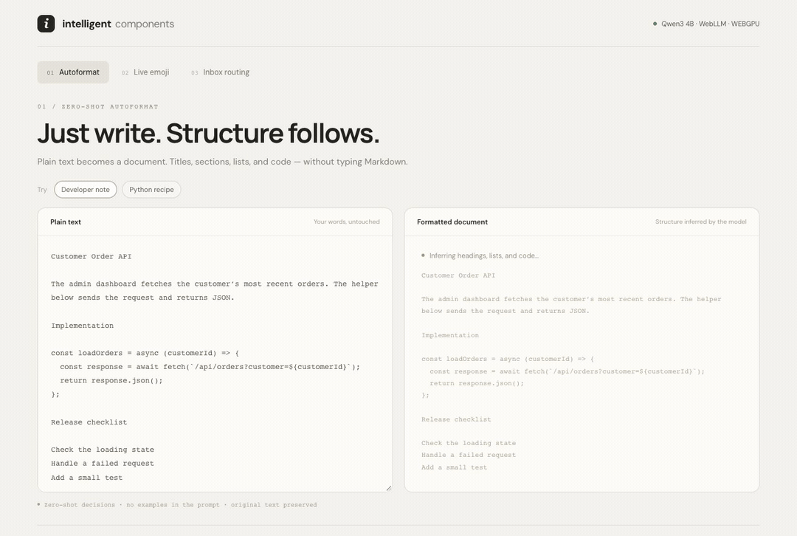
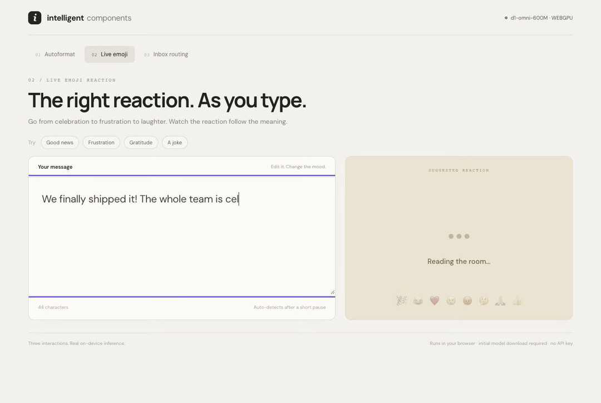
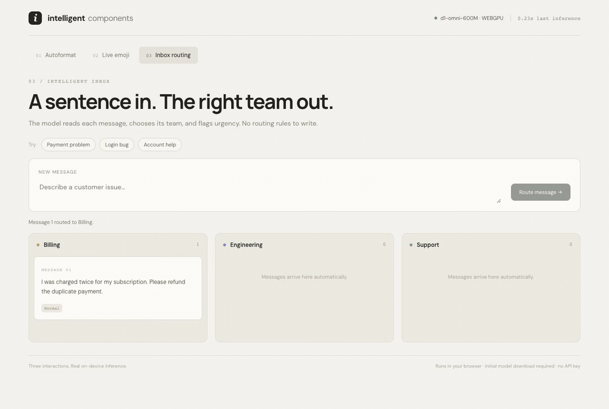

# jev-react-ui

React inputs and controls that use compact models for bounded decisions and short text transformations. Components are unstyled and expose async state through `data-ai-state`, so they can sit inside shadcn/ui or your own design system.

## Quick start

```sh
npm install jev-react-ui
```

Wrap the controls in `JevProvider`. The decision runtime loads on first use and runs locally in the browser: WebGPU when available, WASM otherwise.

```tsx
import { useState } from 'react';
import { JevProvider, EmojiPicker, SmartPriority, SmartCategory } from 'jev-react-ui';

export function Composer() {
  const [message, setMessage] = useState('The production database is down');
  const [emoji, setEmoji] = useState('');
  return <JevProvider model="kev-0.6b">
    <textarea value={message} onChange={e => setMessage(e.target.value)} />
    <EmojiPicker text={message} onSelect={setEmoji} />
    <SmartPriority text={message} onSelect={value => console.log(value)} />
    <SmartCategory text={message} options={['bug','feature','question','incident']} />
    <output>{emoji}</output>
  </JevProvider>;
}
```

The default decision model is `kev-0.6b` from the open-jev ecosystem. It downloads its quantized weights once and keeps them in the browser cache. Set `device` and `dtype` in `JevProvider` to configure inference, or pass your own `DecisionRuntime`/`GenerationRuntime` to connect another local model. Generative controls use a separate lazy Transformers.js pipeline; the default is Liquid AI's `LFM2.5-230M-ONNX` Q4 model and it only loads when you invoke a generation action. The live demo includes a `d1-omni-600M` worker adapter; use the runtime interface when integrating another model.

## Component set

| Area | Components |
| --- | --- |
| Text inputs | `SmartAutocomplete`, `EmojiPicker`, `SmartTextarea`, `SmartTags`, `SmartMention`, `SmartSearch`, `SmartInput` |
| Selection and classification | `SmartIcon`, `SmartColor`, `SmartCategory`, `SmartPriority`, `SmartStatus`, `SmartRoute`, `SmartSentiment`, `SmartAssignee`, `SmartEnum` |
| Data entry | `SmartDatePicker`, `SmartAddress`, `SmartNumber`, `SmartUnit`, `SmartForm`, `SmartValidation`, `SmartColumnMapper` |
| Display | `SmartTitle`, `SmartSummary`, `SmartHighlight`, `SmartTooltip`, `SmartEmptyState`, `SmartNotification`, `SmartDiff`, `SmartSort`, `SmartFormat` |

Choice components take `text`, a bounded `options` list, optional option `descriptions`, and an `onSelect` callback. `SmartTags` and `SmartColumnMapper` batch related questions. Data-entry and display components that create text use the optional generator and return suggestions for the caller to review or apply.

## Three live demos

Run `npm install` and `npm run dev`, then open `/demos.html`.

1. **Autoformat:** paste plain text; the model infers titles, section headings, lists, and code languages. `<SmartFormat />` renders your source words, with syntax highlighting, without requiring Markdown markers.
2. **Live emoji:** type or change a message and watch the selected reaction change with its meaning.
3. **Inbox routing:** submit customer messages and watch them arrive in Billing, Engineering, or Support.

These demos run real models locally in browser workers. Emoji and routing use Liquid AI's d1-omni-600M. Formatting uses Qwen3 4B through WebLLM, with constrained JSON labels for zero-shot layout and language decisions. Click **Enable on-device model** to download the active model. The formatter requires WebGPU and downloads about 2.2 GB; emoji and routing use a smaller model with a WASM fallback. Model caching depends on available browser storage. No API key is required. Decisions can be wrong; the input remains editable.

GIF previews play at **2× speed**; the [videos](demos/README.md) retain actual inference waits.



| Live emoji | Inbox routing |
| --- | --- |
|  |  |

[Watch the three recorded demos](demos/README.md). The recordings use real inference after model initialization; initial downloads are omitted. Run `npm run verify:demos` for the browser checks or `npm run record:featured` to regenerate the GIFs and videos (Chrome and FFmpeg required). Set `DEMO_URL` or `CHROME_PATH` for another server or Chrome installation.

The earlier fixture gallery is available at `/gallery.html`; its [archived recordings](demos/legacy.md) are component previews rather than real model demonstrations. The gallery also supports hosted Jev and ModelMode. For hosted calls, copy `.env.example` to `.env.local`, set `JEV_API_KEY`, and restart Vite. The same-origin proxy keeps the key on the server.

```tsx
import { JevProvider, SmartFormat } from 'jev-react-ui';

<JevProvider decision={yourDecisionRuntime}>
  <SmartFormat text={plainText} />
</JevProvider>
```

`SmartFormat` makes bounded classification calls through `DecisionRuntime`; it never substitutes generated prose for the source. The [demo worker](src/format-model-worker.ts) and [worker adapter](src/demo-model-runtime.ts) show the on-device implementation. Blank lines provide block boundaries. Inputs are limited to 6,000 characters and 16 blocks. Supply a model suited to document classification; the default small model is not a reliable formatter.

## ModelMode MCP

This repository also includes the existing agent-oriented ModelMode implementation in [`packages/modelmode`](packages/modelmode/README.md). It exposes dataset creation, bounded model search, evaluation, publication, and prediction as MCP tools and a Python API. Agents supply examples and judge model failures; the server handles training and lifecycle controls. Its independent Apache-2.0 license is in that package directory.

Start with the package README. In brief, Python 3.12+ and `uv` are required. Local-only baselines need `uv pip install -e '.[dev]'`; transformer fine-tuning and Modal require the corresponding optional dependencies and Modal setup. Modal training uses paid cloud compute. Configure an MCP host to launch `modelmode-mcp --root /absolute/trusted/workspace`; keep its workspace trusted because published artifacts use joblib. For the component gallery, train and publish its tiny local classifiers with `uv run python examples/ui_components.py --root /tmp/modelmode-ui-demo`, then run `uv run modelmode-serve --root /tmp/modelmode-ui-demo` from `packages/modelmode`. Vite proxies `/__modelmode` to this loopback service. Select ModelMode in the gallery for EmojiPicker, SmartPriority, SmartCategory, or SmartSentiment to evaluate the agent-trained classifier from a real React control.

## Development

```sh
npm run typecheck
npm run build
```

This is an experimental component set. The original 31 components plus `SmartFormat` are implemented, but their usefulness depends on the chosen model and task-specific evaluation. The choice components use bounded decisions; address parsing, dates, generated copy, and other less predictable results are suggestions for people to review before applying. Smart controls trigger inference when their inputs change; applications should debounce and limit model downloads appropriately.
